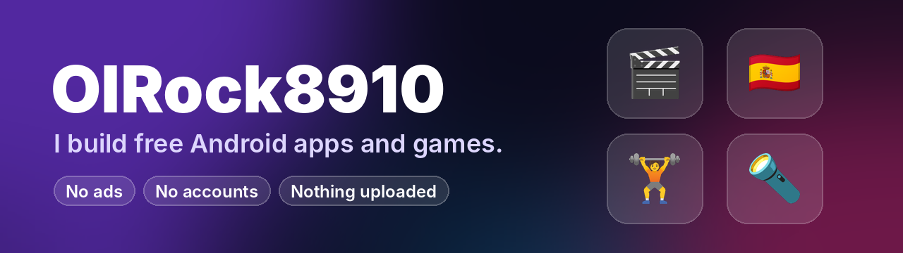

  

### Hi there 👋

I make Android apps and games that are **free to use, with no ads, no sign-ups,
and nothing uploaded** — everything stays on your phone. Most of them live in
[**Unknown Projects**](https://github.com/OlRock8910/Unknown-projects).

## 🚀 Projects

| 🎬 [ReelBox](https://github.com/OlRock8910/Unknown-projects/blob/main/reelbox.md) | 🇪🇸 [Adjetivos](https://github.com/OlRock8910/Unknown-projects/tree/main/adjetivos) | 🏋️ [IronLog](https://github.com/OlRock8910/Unknown-projects/tree/main/ironlog) | 🔦 [Strobe Glyph](https://github.com/OlRock8910/Unknown-projects/tree/main/strobe-glyph) |
|:---:|:---:|:---:|:---:|
|  |  |  |  |
| The videos and music already on your phone, in a streaming-app layout with playlists and lock-screen controls. | Learn Spanish describing words through 19 mini games — bubble pop, word ninja, whack-a-word and more. | A gym tracker with a black-glass look: last time's weights filled in, a graph for every lift, PR celebrations. | A fast flashlight strobe with light shows for the Glyph lights on Nothing phones. |
| TypeScript · Capacitor | JavaScript · Android WebView | Kotlin · Jetpack Compose | Java · Android |

## 🛠️ What I build with

  
  
  
  
  
  
  
  
  
  

## ✅ How my apps work

- **Free** — no ads, no in-app purchases, no accounts.
- **Private** — they work offline and don't upload anything.
- **Tested** — every change is built and tested automatically on GitHub Actions
  before the download is updated.

## 📫 Get in touch

Found a bug or have an idea? [Open an issue](https://github.com/OlRock8910/Unknown-projects/issues) on Unknown Projects.
